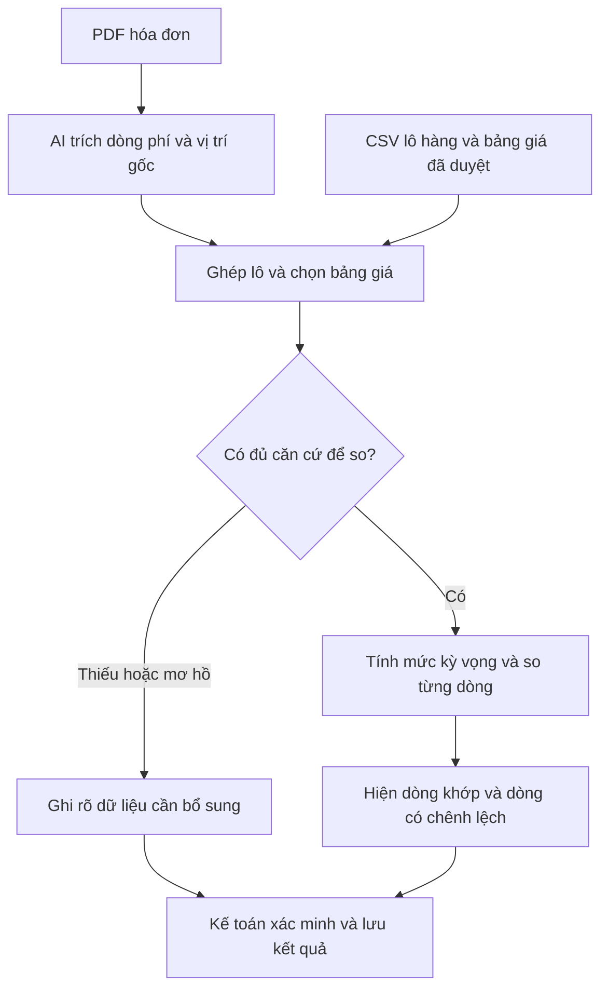

# Movago hoạt động như thế nào?

**Đặc tả luồng kiểm tra và đáp án demo · 08/11/2026 · Slide 5–8**

Movago là thiết kế đề xuất cho kế toán công nợ của một công ty giao nhận. Ứng dụng kiểm tra căn cứ của từng khoản cước trước khi doanh nghiệp thanh toán. **AI đọc chứng từ, quy tắc tính mức phí kỳ vọng, người phụ trách xác nhận kết quả.** Ca INV-095 dùng dữ liệu giả lập. [Phạm vi MVP và cách đo pilot](../colio_ai_project_brief.md) · [Mẫu chứng từ và ca kiểm thử bổ sung](nguon_du_lieu_chung_tu_colio.md)

## 1. Ba nguồn và điều kiện để đối chiếu

| Câu hỏi | Dữ liệu dùng để trả lời | Ai có dữ liệu? |
|---|---|---|
| **Nhà cung cấp đang yêu cầu trả khoản gì?** | Hóa đơn cước hoặc debit note ghi từng dòng phí và số tiền. | Hãng tàu hoặc đại lý gửi cho forwarder. |
| **Khoản phí thuộc lô nào và tính theo điều kiện nào?** | Hồ sơ lô có mã lô, số vận đơn, nhà cung cấp, tuyến, loại container và mốc tính giá. Với một số phí, cần thêm bằng chứng dịch vụ đã phát sinh. | Bộ phận vận hành giữ hồ sơ hoặc xuất từ hệ thống quản lý lô hàng. |
| **Mức nào được phép áp dụng?** | Bảng giá hoặc thỏa thuận đã duyệt, kèm điều kiện, đơn vị tính, hiệu lực và phê duyệt bổ sung nếu có. | Bộ phận quản lý giá hoặc hợp đồng xác nhận. |

**Movago nằm giữa lúc nhận đề nghị chi và lúc duyệt chi.** Ví dụ tại Việt Nam, Maersk công bố hóa đơn phí địa phương cho hàng nhập có trên MyFinance trước khi tàu đến, còn Lacco mô tả nhân viên chứng từ kiểm tra debit note của hãng tàu hoặc đại lý trước khi lập đề nghị thanh toán. Vì thế, loại tài liệu cần đọc phụ thuộc vào quy trình đối tác. Demo chọn một hóa đơn PDF sẵn có trước khi duyệt. [Maersk Việt Nam — mục Import Local Charge Invoice](https://www.maersk.com/local-information/asia-pacific/vietnam/import) · [Lacco — nghiệp vụ chứng từ tại TP.HCM](https://lacco.com.vn/tuyen-dung/tuyen-dung-nhan-vien-chung-tu-xuat-nhap-khau-tai-tp-hcm).

## 2. Luồng kiểm tra trên ca INV-095

### Bước 1 · Nạp ba nguồn

Giả sử kế toán công nợ nhận hóa đơn **INV-095** của nhà cung cấp A cho **lô SHP-001**. Trong bản thử nghiệm, kế toán tải một PDF hóa đơn, một CSV hồ sơ lô và một CSV bảng giá đã duyệt. Dữ liệu ví dụ được bổ sung điều kiện giả lập để thấy vì sao hệ thống chọn đúng dòng giá.

- **Hóa đơn INV-095, trang 1** ghi mã lô SHP-001, cước vận tải $314 (8.000.000 đồng) và “Documentation fee” $51 (1.300.000 đồng). Cả hai khoản tính trước thuế.
- **Hồ sơ SHP-001** ghi nhà cung cấp A, tuyến Singapore → Cát Lái, một container khô 20 feet, một vận đơn và mốc tính giá đã xác nhận là 06/11/2026.
- **Bảng giá RATE-V3** ghi điều kiện khớp với lô, hiệu lực trong tháng 11/2026 theo mốc tính giá đã thỏa thuận, cước $314 (8.000.000 đồng)/container và phí chứng từ $20 (500.000 đồng)/vận đơn ở dòng 12. Bảng giá cũng tính trước thuế.

### Bước 2 · AI đọc PDF và giữ vị trí gốc

Document AI nhận dạng chữ và bố cục để lấy số hóa đơn, mã lô, nhà cung cấp, tiền tệ và các dòng phí. Với mỗi trường, thiết kế lưu giá trị đọc được, giá trị chuẩn hóa, trang và vùng trên PDF nếu trích được. Ví dụ, chữ gốc là “Documentation fee”, giá trị là 1.300.000 VND ($51) và vị trí là dòng phí ở trang 1. Danh mục phí của doanh nghiệp cho phép gắn tên này với mã **DOC**. Với tên lạ, AI có thể gợi ý mã để người dùng xác nhận. [Microsoft Learn — trích xuất trường và dòng hóa đơn](https://learn.microsoft.com/en-us/azure/ai-services/document-intelligence/prebuilt/invoice?view=doc-intel-4.0.0) · [Microsoft Learn — vị trí trên trang](https://learn.microsoft.com/en-us/azure/ai-services/document-intelligence/concept/analyze-document-response?view=doc-intel-4.0.0).

Nếu trường tiền, nhà cung cấp hoặc mã lô mờ hay thiếu nguồn, Movago chuyển trường đó sang kiểm tra. Điểm tin cậy của mô hình giúp ưu tiên việc rà soát. Độ chính xác trên hóa đơn cước Việt–Anh cần đo bằng bộ mẫu của nhóm, kể cả khi công cụ công bố hỗ trợ ngôn ngữ. [Microsoft Learn — ghi chú về năng lực và giới hạn](https://learn.microsoft.com/en-us/azure/foundry/responsible-ai/document-intelligence/transparency-note).

### Bước 3 · Ghép hóa đơn với lô và chọn bảng giá

Movago tìm **SHP-001 + nhà cung cấp A** trong hồ sơ. Nếu hóa đơn dùng số vận đơn, hệ thống tìm qua liên kết vận đơn đã biết. Kết quả ghép cần chỉ đến một hồ sơ phù hợp trong phạm vi MVP. Khi mã tham chiếu bị thiếu hoặc dẫn đến nhiều ứng viên, kế toán chọn hoặc bổ sung bằng chứng trước khi đối chiếu.

Với lô đã xác định, bộ quy tắc chọn dòng giá theo nhà cung cấp, tuyến, loại container, mã phí, đơn vị, tiền tệ và ngày dùng để xét hiệu lực. Ngày đó lấy theo thỏa thuận của lô. Chẳng hạn, biểu phí của Maersk có điều kiện dùng lịch tàu tại lúc xác nhận booking hoặc mốc container vào cảng, tùy nhóm booking và phạm vi áp dụng. Nếu hai mức giá cùng có vẻ phù hợp và chưa có quy tắc ưu tiên đã duyệt, hồ sơ chuyển sang xác minh. [Maersk — điều kiện áp dụng OHC/DHC tại Việt Nam](https://www.maersk.com/news/articles/2026/03/31/terminal-handling-charges-vietnam-ohc-dhc).

### Bước 4 · Tính lại từng khoản theo giá đã duyệt

Hệ thống nhân **số lượng × đơn giá đã duyệt**, rồi so với số tiền trên từng dòng hóa đơn. Ví dụ có một container và một vận đơn, nên hai loại phí đều có số lượng 1 theo đơn vị riêng. Đối chiếu trên cùng tiền tệ và cơ sở trước thuế.

| Dòng phí | Hóa đơn | Mức kỳ vọng từ RATE-V3 | Kết quả |
|---|---:|---:|---|
| Cước vận tải | $314 (8.000.000 đ) | 1 container × $314 | Khớp |
| Phí chứng từ (DOC) | $51 (1.300.000 đ) | 1 vận đơn × $20 (500.000 đ) | Chênh **+$31** (800.000 đ) |
| **Tổng trước thuế** | **$365** (9.300.000 đ) | **$333** (8.500.000 đ) | **Cần xác minh** |

**Phép cộng trên hóa đơn vẫn đúng.** $314 + $51 bằng $365 (8.000.000 + 1.300.000 = 9.300.000 đồng). Chênh lệch xuất hiện khi so dòng DOC với thỏa thuận. Vì vậy, kiểm tra số học của hóa đơn và đối chiếu theo bảng giá là hai phép kiểm riêng.

### Bước 5 · Đưa bằng chứng cho người xác minh

Trên màn hình, kế toán thấy **“Phí chứng từ chênh +800.000 đồng trước thuế”** (+$31) và mở được hai nguồn, **INV-095 trang 1, dòng DOC** và **RATE-V3 dòng 12**. Kế toán bấm **Yêu cầu xác minh** và gửi câu hỏi cho người phụ trách giá về khoản phát sinh.

- **Có phê duyệt bổ sung cho đúng lô.** Đính kèm phê duyệt, chọn lại căn cứ giá đã được xác nhận rồi chạy lại đối chiếu. Giữ lịch sử cảnh báo cũ và lý do thay đổi.
- **Xác nhận hãng tính sai.** Kế toán dùng chứng từ và phép tính trong báo cáo để yêu cầu nhà cung cấp giải thích hoặc điều chỉnh theo quy trình của họ.
- **Chưa đủ tài liệu để quyết định.** Giữ trạng thái cần xác minh và ghi rõ hồ sơ còn thiếu.

Đầu ra của Movago là **kết quả kiểm tra có bằng chứng**. Báo cáo ghi mã lô, mã chứng từ, giá trị hai phía, nguồn, thời điểm và người xác nhận. Phê duyệt chi và thanh toán thuộc quy trình có thẩm quyền của doanh nghiệp. Ví dụ về kênh xử lý thực tế là MyCS của CMA CGM Việt Nam, nơi khách hàng gửi yêu cầu tranh chấp, sửa hoặc hủy hóa đơn. [CMA CGM Việt Nam — quy trình MyCS](https://www.cma-cgm.com/local/vietnam/news/224/notice-of-invoice-dispute-team-s-email-address-deactivation-amp-invoice-dispute-request-on-mycs).

## 3. Sơ đồ một lượt kiểm tra

## 4. Quy tắc cho các trường hợp ngoại lệ

| Tình huống | Movago xử lý thế nào trong thiết kế |
|---|---|
| **Không có bảng giá cho mã phí** | Hiện **Thiếu căn cứ**. Cần bổ sung giá hoặc phê duyệt. Chênh lệch chỉ tính khi có mức kỳ vọng hợp lệ. |
| **Cùng PDF được gửi lại** | So dấu vân tay của tệp để nhận bản giống hệt, kể cả đổi tên file. Khi tệp khác nhau, kiểm tra định danh như nhà cung cấp, ký hiệu và số hóa đơn nếu có. Hiện bản cũ để người dùng xác nhận. |
| **Cùng số vận đơn, hai hóa đơn** | Kiểm tra từng định danh và loại phí. Một vận đơn có thể có nhiều hóa đơn. Trạng thái đã trả cần đối chiếu sổ công nợ, cổng hãng hoặc bằng chứng thanh toán. [Maersk Việt Nam — hướng dẫn thanh toán, mục Rate of Exchange và MyFinance](https://www.maersk.com/local-information/asia-pacific/vietnam/payment) |
| **Phí lưu container tính theo ngày** | Chuyển sang xác minh nếu thiếu thời gian miễn phí, thời điểm lấy hoặc trả container, hoặc điều khoản áp dụng. Với Maersk, phí lưu trong cảng và phí giữ ngoài cảng dựa trên các mốc vận hành khác nhau. [Maersk Việt Nam — Demurrage and Detention](https://www.maersk.com/local-information/asia-pacific/vietnam/import) |
| **Có hóa đơn điều chỉnh hoặc thay thế** | Giữ liên kết với chứng từ trước đó và chuyển người phụ trách xác nhận bản có hiệu lực. |

## 5. Phạm vi và bộ ca nghiệm thu

**Phạm vi đầu tiên.** Một nhà cung cấp, một lô trên mỗi hóa đơn VND, vài mã phí có đơn giá cố định và bảng giá đã được nhập thành cột. Luồng cần làm được là tải hồ sơ, mở bằng chứng từng dòng và lưu kết quả xác minh. Bảng giá phải do người phụ trách duyệt. Nếu bảng giá chỉ có trong email hoặc phụ lục PDF, bước chuẩn hóa và kiểm tra bảng giá cần thực hiện trước.

| Ca nghiệm thu | Đáp án dự kiến |
|---|---|
| Hóa đơn khớp giá và đúng lô | Khớp trong phạm vi kiểm tra. Hiện căn cứ hai phía. |
| INV-095 trước khi có phê duyệt bổ sung | Cước chính khớp. Dòng DOC chênh +$31 (800.000 đồng) trước thuế. Mở được hóa đơn trang 1 và RATE-V3 dòng 12. |
| Thiếu bảng giá hoặc có hai phiên bản cùng điều kiện | Thiếu căn cứ. Ghi dữ liệu cần bổ sung và để trống mức chênh lệch. |
| Cùng PDF đổi tên rồi tải lại | Hiện bản đã ghi nhận. Trạng thái thanh toán cần sổ công nợ hoặc bằng chứng chi. |
| Dòng tiền trên ảnh mờ | Yêu cầu người dùng kiểm tra vùng trích trước khi tính. |
| Chênh lệch có phê duyệt bổ sung | Lưu phê duyệt, chạy lại với căn cứ đã xác nhận và giữ lịch sử kết quả cũ. |

**Căn cứ của thiết kế.** Hướng dẫn nghiệp vụ của GSA Hoa Kỳ mô tả kiểm tra cước bằng cách ghép hóa đơn với vận đơn, kiểm tra mức phí và xác nhận dịch vụ đã thực hiện. Tài liệu công khai của Conlio và ShipCheck mô tả cách đối chiếu hóa đơn với thông tin vận tải và biểu phí. Luồng trong tài liệu là đề xuất cho Movago và cần kiểm thử trên dữ liệu của nhóm. [GSA — Transportation Invoice Audit](https://www.gsa.gov/policy-regulations/policy/transportation-management-policy/transportation-invoice-audit) · [Conlio — mô tả dịch vụ, mục 3](https://www.conlio.com/terms-conditions) · [ShipCheck — mục Freight Audit](https://shipcheck.com/en).

*Ghi chú phương pháp. Đọc brief và đối chiếu hướng dẫn của hãng tàu, mô tả nghiệp vụ và tài liệu kỹ thuật công khai. AI hỗ trợ tra cứu và tổng hợp.*
