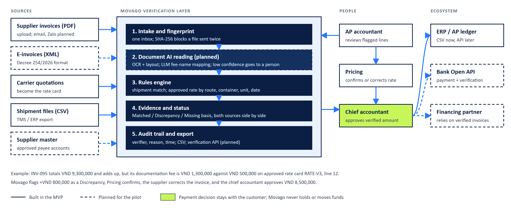
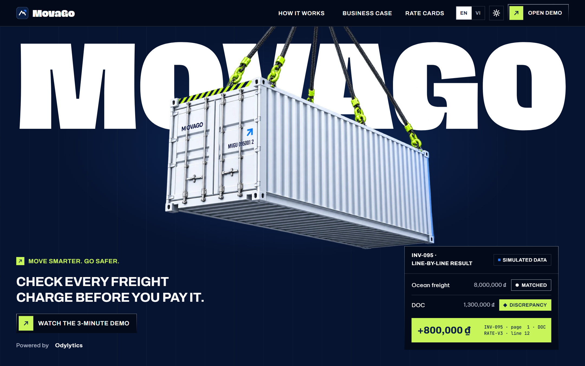
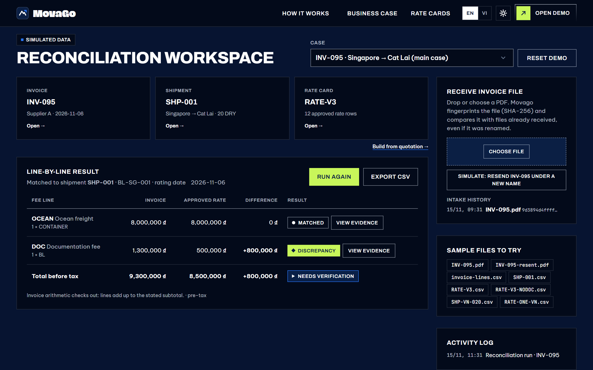
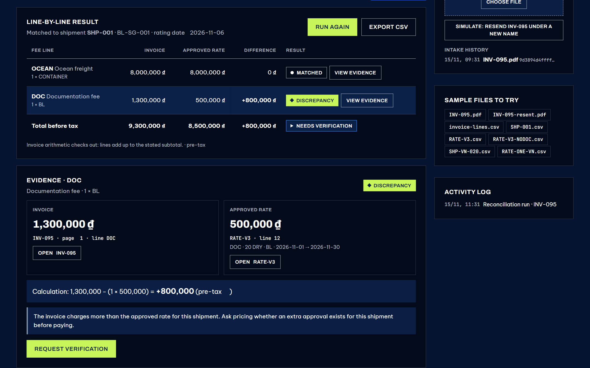
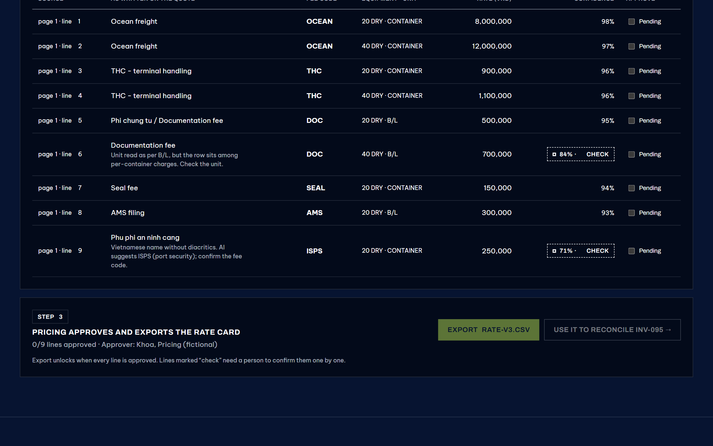

<!-- cover -->
# Movago

Verifying B2B freight payments before the money moves

**Team:** Odylytics

**Primary pillar:** Pillar 5, Trust Architecture & Financial Integrity

**Secondary pillar:** Pillar 2, Financial Infrastructure & Ecosystem Interoperability

**Working prototype:** https://movago.odylytics.com

**Prototype guide:** https://docs.google.com/document/d/1GHJaJQgfQMNODwn2Mi6oo6TlpxobigB70ynNizR9qro/edit?usp=drivesdk

RMIT Hack-A-Venture 2026 · Round 1 Idea Proposal
<!-- pagebreak -->

## 1. Executive Summary

Vietnam's payment rails are becoming faster and safer, but in business-to-business (B2B) payments part of the risk sits in the invoice that justifies a transfer, before any bank sees it. Movago addresses this under **Pillar 5, Trust Architecture & Financial Integrity**, with Pillar 2 as a secondary focus.

**Problem.** Freight forwarders approve carrier and agent invoices by checking them by hand against shipment files and approved rate cards spread across email, chat and spreadsheets. An invoice whose total adds up can still be overcharged line by line, and nothing records who verified what.

**Solution.** Movago is a pre-payment verification layer. It reads each fee line, matches it to the shipment and the approved rate, labels it *Matched*, *Discrepancy* or *Missing basis* with evidence from both sides, and routes exceptions to the right person before payment is approved.

**Target market.** Mid-sized sea-freight forwarders in Ho Chi Minh City first, then other businesses with high recurring supplier payments.

**Impact.** Fewer incorrect payments, faster and auditable approvals, and Vietnam's first measured rate of freight invoice errors.

## 2. Problem Statement & Market Pain

### Significance and urgency

Cashless transactions passed 15 billion in the first half of 2026, up 34.3% year on year, and by the end of July 2026 the State Bank's SIMO system had helped about 1.6 million customers stop suspicious transfers worth around VND 5.5 trillion (VnEconomy, 2026; VietNamNet, 2026). SIMO protects the transfer. When an accountant approves an incorrect supplier invoice, the bank executes a payment that is valid in form but wrong in substance.

Freight is where this gap is widest. Goods trade reached USD 1,010.55 billion in the first ten months of 2026, up 32.3% (National Statistics Office, 2026), and logistics costs equal about 16% of GDP against a national target of 12–15% by 2035 (Vietnam Investment Review, 2026; Decision No. 2229/QĐ-TTg, 2025). New e-invoice rules under Decree 254/2026/NĐ-CP are changing how these invoices are issued and corrected, so control processes have to change with them.

### Root causes

1. **Fragmented evidence.** The invoice, the shipment file and the approved rate card live in different channels and systems.
2. **Complex pricing conditions.** The correct price depends on container size, route, unit and validity date; carriers publish different handling charges for 20' and 40' containers (Maersk, 2026).
3. **Total-level checks.** Under time pressure, staff often verify only that the invoice adds up.
4. **No shared verification record.** Approvals rarely show which source each number was checked against.

In our test case, invoice INV-095 sums correctly to VND 9,300,000, yet its documentation fee is VND 1,300,000 against an approved VND 500,000, an overcharge of VND 800,000 that a sum check passes.

### Groups affected

Accounts-payable (AP) accountants carry the manual work; chief accountants and CFOs carry the payment risk; pricing and operations teams are pulled into repeated queries; and forwarders' own customers may be re-billed for charges that were never confirmed. The work is real enough to be a job in its own right: Flexport is hiring an *Auditor, Accounts Payable & Freight Audit* in Ho Chi Minh City to validate freight invoices against contracts, rate agreements and shipment records (Flexport, 2026).

### Evidence of scale

Vietnam has no published figure for freight invoice errors. According to a US freight audit provider, 3–6% of freight invoices contain errors and 1–5% of freight spend is recoverable (Transportation Insight, n.d.). Processing one AP invoice costs a median of USD 6 across 5,846 organisations (APQC, n.d.).

## 3. Solution Architecture & FinTech Integration

### Core features against root causes

| Root cause | Movago feature |
| --- | --- |
| Fragmented evidence | One intake for invoices, quotations and shipment files; SHA-256 fingerprint blocks the same file sent twice |
| Complex pricing | Rules engine selects the approved rate by route, container, unit and validity date |
| Total-level checks | Line-by-line reconciliation with arithmetic checks |
| No verification record | Two-sided evidence, named verifier and reason, CSV audit export |

### Users and workflow

The **AP accountant** uploads or receives the invoice and reviews flagged lines. **Pricing** confirms or corrects rates. The **chief accountant** approves the verified amount. Figure 1 shows the end-to-end process.

*Figure 1. Movago system topology and end-to-end process. Dashed elements are planned for the pilot.*

### Technology stack and FinTech role

| Layer | Technology | Status |
| --- | --- | --- |
| Intake | Web upload, SHA-256 fingerprint; email and Zalo connectors | Built; connectors planned |
| Reading | Document AI (OCR with layout); LLM mapping of Vietnamese and English fee names with confidence scores | Planned |
| Matching | Deterministic TypeScript rules engine, 14 automated tests | Built |
| Review | Evidence view, verification requests, audit trail | Built |
| Output | CSV export; ERP and bank connectors | Built; connectors planned |

AI handles reading, where documents vary; the rules engine handles money decisions, so every result is explainable and testable. Anything below the AI confidence threshold goes to a person.

### Open Innovation

Movago starts from files every forwarder already has, then connects outward:

- **Shared data:** structured e-invoices under the tax authority's rules, and a fee-code dictionary built with the VLA and HLA associations so suppliers and buyers describe charges the same way.
- **Open APIs:** a verification API that ERP and TMS vendors can call, and bank Open APIs to attach the verification result to the payment instruction.
- **Collaboration:** banks offering supply-chain finance can rely on verified invoice data instead of re-checking documents.

### Innovation and differentiation

Existing tools compare an invoice with the system's own cost accrual or with a purchase order. Movago checks against the rate card pricing actually approved and shows both sources, which is the evidence an auditor or a bank needs.

### Barriers and mitigation

| Barrier | Mitigation |
| --- | --- |
| Personal data (Law 91/2025/QH15; Decree 356/2025/NĐ-CP) | Field-level control over data sent to AI providers, anonymised pilot data, agreed retention and deletion |
| AI misreading documents | Confidence thresholds, human confirmation, deterministic pricing rules |
| Missing or outdated rate cards | Rate-card builder from quotations; report coverage separately |
| Legacy ERP and TMS | File-based start (CSV, PDF, e-invoice XML) before deep integration |
| Payment regulation | Movago never holds or moves funds; approval stays with the customer |

## 4. Market Size & Competitive Analysis

### Target market and customer segmentation

| Segment | Need | Expected value |
| --- | --- | --- |
| Mid-sized sea-freight forwarders, Ho Chi Minh City (primary) | Faster, defensible AP checks | Fewer overpayments; staff time released |
| Importers and exporters with high freight spend | Control over pass-through charges | Pay only confirmed charges |
| Banks and supply-chain finance providers (partners) | Reliable invoice data | Lower verification cost |

Adoption motivation is direct: a saving that shows on the next payment run, with no system replacement.

### Market sizing and demand

The global freight audit and payment market is valued at about USD 0.8–1.0 billion in 2025, growing 13–14% a year and fastest in Asia-Pacific (Knowledge Sourcing Intelligence, 2025; Mordor Intelligence, n.d.). Vietnam has around 4,000–4,500 freight forwarding companies (Ministry of Industry and Trade, 2026). If 10% fit our profile, an assumption we will test through interviews, the serviceable market is about USD 560,000 a year; our year-three target is 30 customers, about USD 42,000 a year.

### Revenue model

- **Subscription** priced by unique invoices processed; indicative USD 1,400 per customer a year.
- **Setup fee** for rate-card normalisation and configuration.
- **Verification API** fees per check for ERP, TMS and financing partners (later).

Main costs are cloud hosting, document AI and LLM usage per page, onboarding and the core team. In an illustrative scenario of 1,000 invoices a month, cutting handling time from 15 to 9 minutes releases about 100 staff hours a month; at a usage cost of VND 3 million a month, saving 3 minutes per invoice covers the cost. These are assumptions the pilot will replace with measured results.

### Competitive landscape

| Alternative | Strengths | Limitations | Movago difference |
| --- | --- | --- | --- |
| Excel and manual checks | Free, familiar | Slow, total-level, no audit trail | Line-level evidence and audit trail |
| CargoWise Invoice Processing Portal | Built into a widely used TMS | Compares with the system's own accruals | Checks against the approved rate card |
| Innomation AutoMatching | AI matching with PO and contracts, local ERP links | Not built for freight pricing conditions | Rules for route, container and validity |
| Global freight audit providers | Mature audit services | Focused on US and EU shippers | Vietnamese fee names, local workflow |

**USP:** every flagged amount is traceable to an openable source on both sides. **Barriers to imitation:** a labelled dataset of Vietnamese fee names, layouts and errors that grows with each customer, and approval workflows embedded in customers' AP process.

## 5. Strategic Contribution & Expected Impact

Movago improves the **reliability of financial information** at the point where B2B money is committed. Incorrect payments are stopped before they reach the bank, and each approval carries its own evidence.

**Beneficiaries and scale.** AP teams gain time, finance leaders gain control, suppliers with correct invoices are paid faster, and customers are billed only for confirmed charges. At 1–5% of freight spend, the recoverable value across Vietnam's trade flows is material.

### Measurable indicators

| Indicator | Method | Pilot target |
| --- | --- | --- |
| Median handling time per invoice | Timed comparison, same invoice sets | At least 30% lower |
| Alert quality | Precision and recall against confirmed labels | Reported with numerators |
| Overpayment flagged, confirmed, recovered | Tracked separately in VND | Reported, not extrapolated |
| Line coverage | Share of lines with a verifiable basis | Reported by fee type |

**Long-term value.** Revenue comes from customers who save more than they pay; no grant is needed to operate.

**Risks and balance.** Suppliers may resist more disputes; shared evidence shortens disputes for both sides. AI vendors may change; the reading layer is replaceable. Rules can be updated as e-invoice regulations evolve.

### SDG alignment

- **SDG 8:** releases skilled accounting time from manual cross-checking towards analysis.
- **SDG 9:** gives smaller logistics firms verification infrastructure that large shippers buy from audit providers.
- **SDG 16 (target 16.6):** strengthens accountable, transparent payment approval inside enterprises.

## 6. Implementation Roadmap & Scalability

### Quarterly roadmap

| Quarter | Milestone | Depends on |
| --- | --- | --- |
| Q4 2026 | MVP live; interviews with 5–10 forwarders | Completed prototype |
| Q1 2027 | Backend with audit log; document AI reading | Pilot partner signed |
| Q2 2027 | Pilot on 30–100 anonymised invoice sets | Data agreement |
| Q3 2027 | Results published; payee-account check; e-invoice XML intake | Pilot results |
| Q4 2027 | First paid customers; ERP and TMS export integration | Pricing validated |
| Q1–Q2 2028 | Bank and financing partner integration via API | Partner agreements |

### Scalability and infrastructure

New fee categories such as trucking, warehousing and customs need new rate rules, not a new product, and new customers reuse the same multi-tenant service, so operating costs grow with usage rather than with headcount. The verification API lets banks, fintechs, ERP vendors and enterprises plug in without custom builds. Infrastructure is a cloud service with a Vietnamese data-residency option; the same model can serve forwarders in other ASEAN markets with similar documents.

### Delivery capacity

Odylytics is a student-founded AI firm in Ho Chi Minh City that turns research into working products. Its first platform, AquaGuard (aquaguard.vn), coordinates flood victims, rescue teams and coordinators and is already used by communities in flood season; the team presented it at the TECH PLANTER Vietnam 2026 Demo Day organised by Leave a Nest Group. The team has repeatedly taken ideas to working MVPs under competition conditions, including Includio at the RMIT ADC Hackathon 2026, and has won several AI and innovation competitions. On the business side, the CEO works as a venture analyst at B71 (NUS Enterprise) and leads fundraising and investor relations, and the team collaborates with universities in Vietnam, Australia, the United States, France and Canada.

## References

APQC. (n.d.). *What is the average cost to process an invoice?* https://www.apqc.org/What-Is-the-Average-Cost-to-Process-an-Invoice

Decision No. 2229/QĐ-TTg. (2025). Prime Minister of Vietnam. https://datafiles.chinhphu.vn/cpp/files/vbpq/2025/10/2229-ttg.signed.pdf

Flexport. (2026). *Auditor, Accounts Payable & Freight Audit* [Job posting, Ho Chi Minh City]. https://job-boards.greenhouse.io/flexport/jobs/7660304

Knowledge Sourcing Intelligence. (2025). *Freight audit and payment market: Forecasts 2025–2030*. Research and Markets. https://www.researchandmarkets.com/reports/6176216/freight-audit-payment-market-forecasts

Maersk. (2026, March 31). *Terminal handling charges Vietnam: OHC and DHC*. https://www.maersk.com/news/articles/2026/03/31/terminal-handling-charges-vietnam-ohc-dhc

Ministry of Industry and Trade. (2026). *Vietnam logistics report 2025*. https://proship.vn/wp-content/uploads/2026/03/Bao-cao-Logistics-Viet-Nam-2025.pdf

Mordor Intelligence. (n.d.). *Freight audit and payment market*. https://www.mordorintelligence.com/industry-reports/freight-audit-and-payment-market

National Statistics Office. (2026, November). *Socio-economic situation in October and the first ten months of 2026*. https://www.nso.gov.vn/bai-top/2026/11/mot-so-net-chinh-tinh-hinh-kinh-te-xa-hoi-thang-10-va-10-thang-nam-2026/

Transportation Insight. (n.d.). *Freight audit and payment: Protect profit from soft rates*. https://transportationinsight.com/resources/freight-audit-payment-protect-profit-soft-rates/

Vietnam Investment Review. (2026, August 28). Vietnam logistics costs account for 16 per cent of GDP. https://vir.com.vn/vietnam-logistics-costs-account-for-16-per-cent-of-gdp-159581.html

VietNamNet. (2026, August 13). Vietnam bank alerts stop 1.6 million suspected scam transactions. https://vietnamnet.vn/en/vietnam-bank-alerts-stop-1-6-million-suspected-scam-transactions-2545014.html

VnEconomy. (2026, August 12). Vietnam's cashless payment transactions rise 34.3% in first half. https://en.vneconomy.vn/vietnams-cashless-payment-transactions-rise-343-in-first-half.htm

## Appendix

Supplementary material. It is not scored and is not needed to follow the main report.

### A. Working prototype

The prototype runs at https://movago.odylytics.com without login. A step-by-step guide is at https://docs.google.com/document/d/1GHJaJQgfQMNODwn2Mi6oo6TlpxobigB70ynNizR9qro/edit?usp=drivesdk. All data in the prototype is simulated.

*Figure A1. Landing page with the INV-095 result summary.*

*Figure A2. Reconciliation workspace: INV-095 matched to shipment SHP-001; ocean freight matches, the documentation fee is flagged +VND 800,000 while the invoice total still adds up.*

*Figure A3. Evidence view for the DOC line: invoice page 1 next to RATE-V3 line 12, the calculation, and the verification request.*

*Figure A4. Rate-card builder: nine lines read from quotation Q-SA-2611 with their position and confidence; two low-confidence lines are marked for a person to check.*

### B. Test case data (INV-095)

| Source | Line | Fee | Condition | Amount (VND) |
| --- | --- | --- | --- | --- |
| Quotation Q-SA-2611 | Line 5 | Documentation fee (DOC) | 20' dry, per B/L, valid 1–30 Nov 2026 | 500,000 |
| Approved rate card RATE-V3 | Line 12 | DOC, normalised from the quotation | Supplier A, Singapore to Cat Lai | 500,000 |
| Invoice INV-095 | Page 1 | Ocean freight | 1 container | 8,000,000 |
| Invoice INV-095 | Page 1 | Documentation fee | 1 B/L | 1,300,000 |
| Invoice INV-095 | Total | Before tax | Adds up correctly | 9,300,000 |
| Corrected invoice INV-095-A | Total | Before tax | After the supplier's correction | 8,500,000 |

### C. Automated acceptance tests

All 14 tests pass on the prototype's rules engine (Vitest).

| Area | What the test checks |
| --- | --- |
| Reconciliation | INV-095: freight matches; DOC +800,000 pre-tax, sourced to page 1 and RATE-V3 line 12 |
| Reconciliation | Matching variant: both lines match, total 8,500,000 |
| Reconciliation | Missing DOC rate: the line becomes *Missing basis*, with no expected amount |
| Reconciliation | INV-VN-020: a 40' rate charged on a 20' container is flagged +1,800,000 |
| Reconciliation | Two matching rate rows make the line *Missing basis* instead of guessing |
| Reconciliation | The rate version follows the rating date (October shipment priced on RATE-V2) |
| Reconciliation | Two containers invoiced on a one-container shipment are flagged |
| Duplicates | A renamed but identical PDF is detected as already received |
| Rate-card builder | Approving all quotation lines reproduces the Supplier A rows of RATE-V3 |
| Rate-card builder | Unapproved lines stay out of the exported rate card |
| Rate-card builder | Low-confidence lines are flagged for one-by-one review |
| Business case | 1,000 invoices, 15 to 9 minutes, VND 60,000 per hour: 100 hours and VND 6,000,000 a month; a VND 3,000,000 fee breaks even at 3 minutes |
| Business case | Saving 3 and 9 minutes gives VND 3 and 9 million a month |
| Business case | No negative savings; zero volume handled |

### D. Calculations behind the figures

All figures below are illustrative assumptions for the pilot to test, not results. Exchange rate: USD 1 = VND 25,500.

| Figure in the report | Calculation |
| --- | --- |
| Overcharge on INV-095 | 1,300,000 − 500,000 = VND 800,000 (about USD 31) |
| 100 staff hours a month | 1,000 invoices × (15 − 9) minutes = 6,000 minutes = 100 hours |
| Value of time released | 100 hours × VND 60,000 per hour (assumed loaded cost) = VND 6,000,000, about USD 235 a month |
| Usage cost | VND 3,000,000 a month, about USD 118; × 12 ≈ USD 1,412 a year |
| Indicative price | About USD 1,400 per customer a year, rounded from the usage cost |
| Break-even at 3 minutes | VND 3,000,000 ÷ VND 60,000 = 50 hours = 3,000 minutes ÷ 1,000 invoices = 3 minutes per invoice |
| Serviceable market | 4,000 forwarders × 10% (assumption) = 400 × USD 1,400 = USD 560,000 a year |
| Year-three target | 30 customers × USD 1,400 = USD 42,000 a year |

### E. Evidence for key claims

| Claim in the report | Source | What the source says |
| --- | --- | --- |
| Freight invoice auditing is a real job in Ho Chi Minh City | Flexport (2026) | Job posting for an AP and freight audit auditor in Ho Chi Minh City, validating freight invoices against contracts, rate agreements and shipment records |
| Logistics costs about 16% of GDP; target 12–15% | Vietnam Investment Review (2026); Decision No. 2229/QĐ-TTg (2025) | Logistics costs remain at about 16% of GDP; the 2025–2035 strategy aims for 12–15% |
| SIMO helped stop about VND 5.5 trillion in suspicious transfers | VietNamNet (2026) | About 1.6 million customers stopped suspicious transactions by the end of July 2026 |
| 15 billion cashless transactions, +34.3% | VnEconomy (2026) | Cashless transactions in the first half of 2026 rose 34.3% |
| Goods trade USD 1,010.55 billion, +32.3% | National Statistics Office (2026) | Ten-month 2026 import and export turnover |
| Different handling charges for 20' and 40' containers | Maersk (2026) | Separate terminal handling charges by container size in Vietnam |
| 3–6% of freight invoices contain errors | Transportation Insight (n.d.) | US freight audit provider's figure for a typical audit; 1–5% of spend recoverable |
| USD 6 median cost per AP invoice | APQC (n.d.) | Benchmark across 5,846 organisations |
| 4,000–4,500 freight forwarders in Vietnam | Ministry of Industry and Trade (2026) | Vietnam Logistics Report 2025, citing the VLA |

### F. Team track record

- AquaGuard, flood-rescue coordination platform: https://aquaguard.vn
- TECH PLANTER Vietnam 2026 Demo Day and RMIT ADC Hackathon 2026: https://odylytics.com/#/blog
- Team profiles: https://odylytics.com/#/team/co-founders
